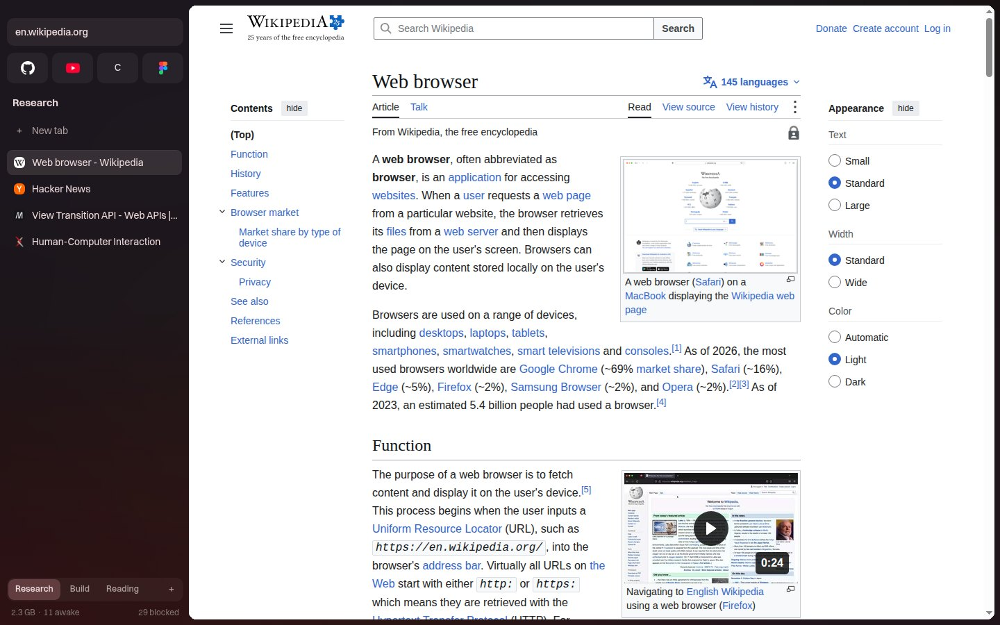
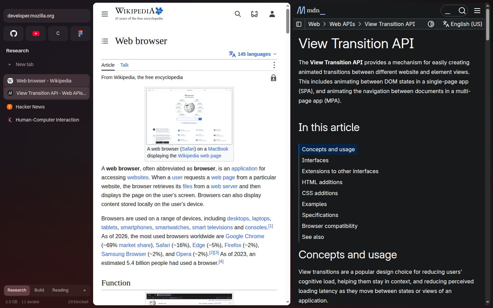
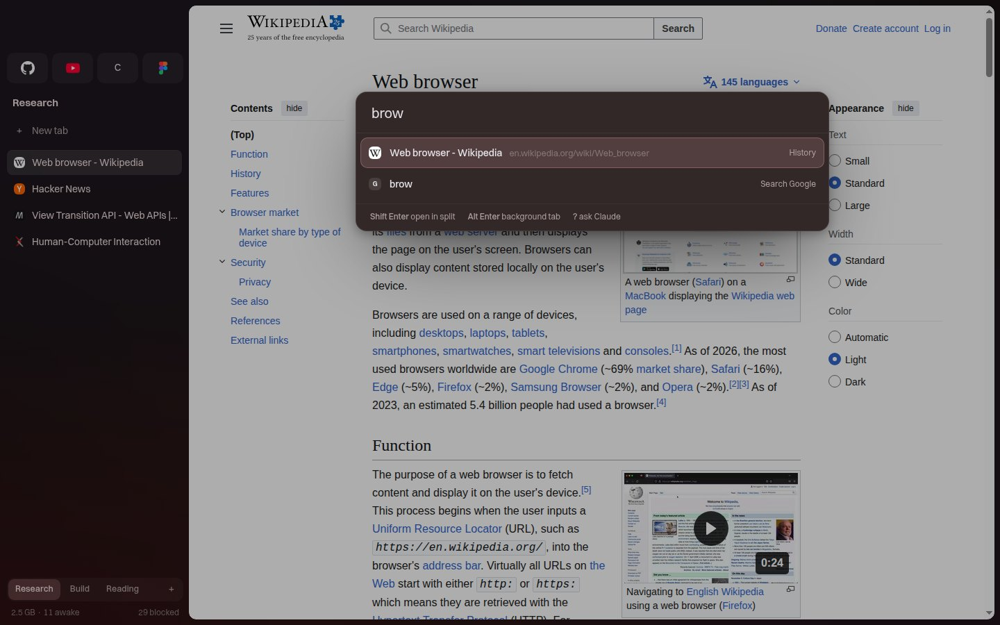
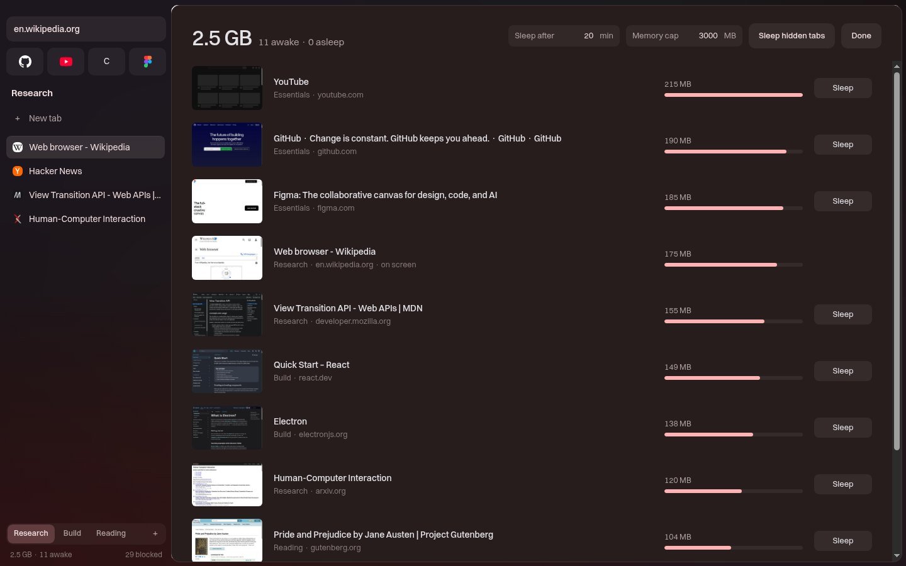
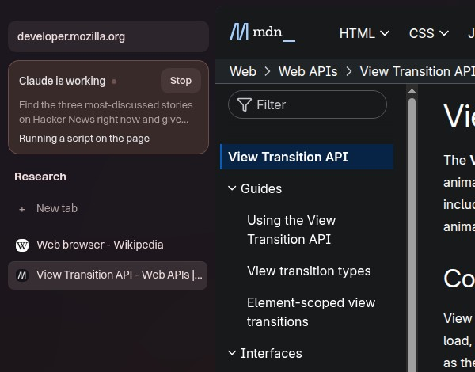
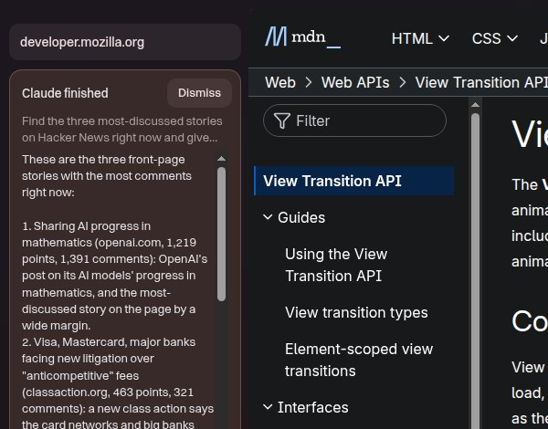

<h1 align="center">Drift</h1>
<p align="center"><b>For those who can't find the browser best for them.</b></p>
<p align="center">A Chromium browser for Linux with spaces you swipe between, splits you drag into place, tabs that sleep on their own, and Claude built in.</p>
<p align="center"><a href="https://sisiphamus.github.io/drift-browser/">Website</a> · <a href="#install">Install</a> · <a href="#ask-claude">Ask Claude</a> · <a href="#against-brave">Against Brave</a> · <a href="ARCHITECTURE.md">Architecture</a></p>



## What it does

- **Spaces.** Each project gets its own tabs and color. Swipe two fingers across any page (or `Ctrl Alt` and an arrow) to move between them. Pinned sites follow you into every space.
- **A sidebar that gets out of the way.** It tucks away until your pointer touches the left edge. Drag tabs to reorder them, pin them, or move them to another space.
- **Split anything.** Drag a tab onto a page edge and the panes spring into place. Resize, nest, pull back out.
- **One command bar.** `Ctrl T` searches open tabs, history, bookmarks and every command. `Shift Enter` opens in a split, `Alt Enter` in the background, and starting with `?` hands the task to Claude.
- **Tabs that look after themselves.** Hidden tabs drop their caches after 30 seconds and sleep after 20 minutes or when you pass your memory cap. `Ctrl Shift M` shows what each tab costs.
- **Chrome extensions.** One click from the Chrome Web Store. Extensions that save settings through `chrome.storage.sync` keep working.
- **Bring your stuff.** Imports bookmarks, history, extensions, logins and cookies from Brave, and logins and cookies from Zen or Firefox.

| Split view | Command bar | Memory view |
|---|---|---|
|  |  |  |

## Ask Claude

Ask for something and Claude works in its own **Agent space**, with your logins, in background tabs you never have to look at. Your view never moves. The sidebar shows each step with a Stop button, and the answer when it's done.

| While it works | When it's done (a real run) |
|---|---|
|  |  |

Agents treat you as away: they read text CAPTCHAs, work out why a form won't submit, and stop only for things that need you, like a code from your phone. They never pay or message anyone unless the task says to.

Drift also ships an **MCP server** (`bin/drift-mcp.mjs`, zero dependencies), so Claude Code or any MCP client can drive it the same way:

```sh
claude mcp add drift -- node "$PWD/bin/drift-mcp.mjs"
```

Tools: `drift_open`, `drift_tabs`, `drift_use_tab`, `drift_read`, `drift_screenshot`, `drift_click`, `drift_type`, `drift_eval`, `drift_wait`, `drift_scroll`, `drift_go`, `drift_show`, `drift_close`.

## Against Brave

Same 8 real sites in each browser, Linux, headless, then an idle window. Memory is the total across every browser process (PSS).

| | Drift | Brave |
|---|---|---|
| Idle CPU | about 2.5% | 9 to 29% |
| Processes | 19 | 27 |
| Memory | 872 MB | 898 MB |

Memory is close; the CPU gap is the real difference. Reproduce it with `node scripts/bench.mjs drift` and `node scripts/bench.mjs brave`.

## Install

Linux with Node 22 or newer. Runs on Wayland or X11.

```sh
git clone https://github.com/sisiphamus/drift-browser
cd drift-browser
npm install        # also fetches the UI font (Switzer, from Fontshare)
npm run build
npx electron .     # or: bin/drift.mjs launch
```

`bin/drift.mjs` is the CLI; put it on your PATH as `drift`. Ask Claude needs [Claude Code](https://docs.claude.com/en/docs/claude-code/overview) installed and signed in. To make Drift your default browser, point a `.desktop` entry at it with `%U` and run `xdg-settings set default-web-browser drift.desktop`.

The profile lives in `~/.config/Drift` (override with `DRIFT_PROFILE`). Colors follow matugen through `~/.config/gtk-4.0/gtk.css` and update live when the wallpaper changes.

## Keys

| Keys | Does |
|---|---|
| Ctrl T | New tab (command bar) |
| Ctrl L, Alt D, F6 | Edit address |
| Ctrl W, Ctrl Shift T | Close, reopen tab |
| Ctrl Tab, Ctrl 1 to 9 | Cycle, jump to tab |
| Ctrl Alt Left/Right, Alt 1 to 9, two-finger swipe | Switch space |
| Ctrl Alt \\ | Split with the last tab |
| Ctrl Alt U | Unsplit |
| Ctrl Shift B | Pin or hide the sidebar |
| Ctrl Shift M | Tab memory view |
| Ctrl F, Ctrl D, F12 | Find, bookmark, devtools |
| Ctrl , | Settings |

Right-click a tab for copy link, duplicate, mute, pin, split, move to another space, sleep, close others and more.

## CLI

`drift` talks to `$XDG_RUNTIME_DIR/drift.sock`. Add `--json` to any command for scripting.

```sh
drift open github.com --split right
drift tabs --all                 # ids, memory, state
drift md @2                      # page as Markdown
drift click active "text:Sign in"
drift type active "input[name=q]" "hello" --submit
drift shot active -o page.png --full
drift ws new Research ; drift ws go next
drift ask "find a cheap flight to Austin on Friday"
drift agents                     # Claude runs and their latest step
drift import brave --cookies     # bookmarks, history, extensions, logins
drift import zen                 # logins and cookies
drift help
```

## Privacy and security

- **Blocking:** ads, trackers and cookie banners (Ghostery engine with EasyList, EasyPrivacy and uBlock lists) plus the URLhaus malware and phishing lists. Pages wait for the blocker, so nothing loads unfiltered.
- **Passwords:** sealed with a key in your system keyring (libsecret); Drift refuses to store any without it. Autofill offers a site only its own logins, decided by Chromium's view of the requesting frame, and only after a real click.
- **Private spaces:** in-memory cookies and storage, no history, no extensions, gone when the space closes.
- **Navigation:** http upgrades to https (falling back per host only when https fails); tracking parameters (utm, fbclid, gclid, msclkid and similar) are stripped before the request leaves.
- **Network:** DNS over HTTPS with fallback to the system resolver; WebRTC never exposes local IPs; every request carries Global Privacy Control.
- **Permissions** are remembered per site.

## Development

```sh
npm run dev        # hot reload
npm test           # unit tests
npm run e2e        # builds, then drives a real headless Drift on a throwaway profile
npm run typecheck
```

[ARCHITECTURE.md](ARCHITECTURE.md) maps the code. The end-to-end suite covers tabs, spaces, splits, drags and swipes with real input, popups, ad blocking, extensions, the MCP server and clean quits.

## License

[GPL-3.0](LICENSE). Drift builds on Electron, [electron-chrome-extensions](https://github.com/samuelmaddock/electron-browser-shell) (GPL-3.0) and the [Ghostery adblocker](https://github.com/ghostery/adblocker).
